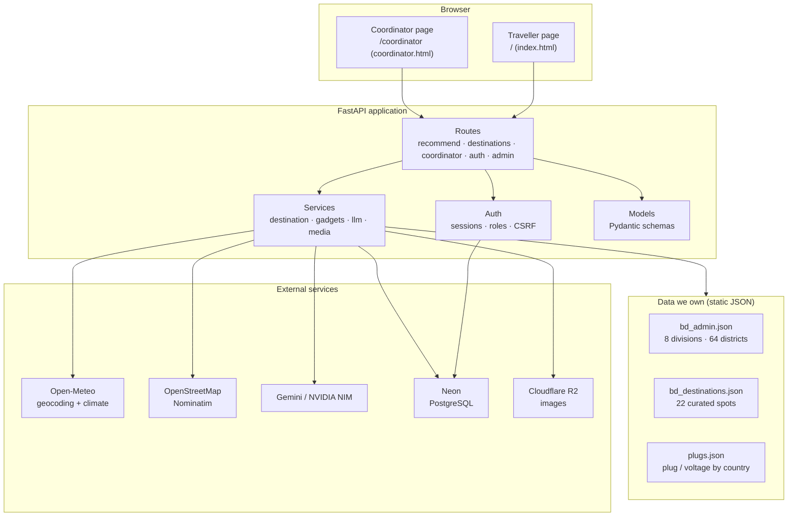
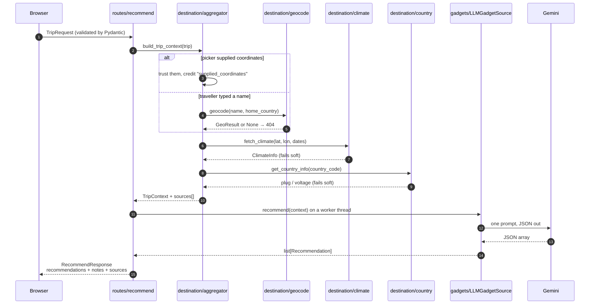
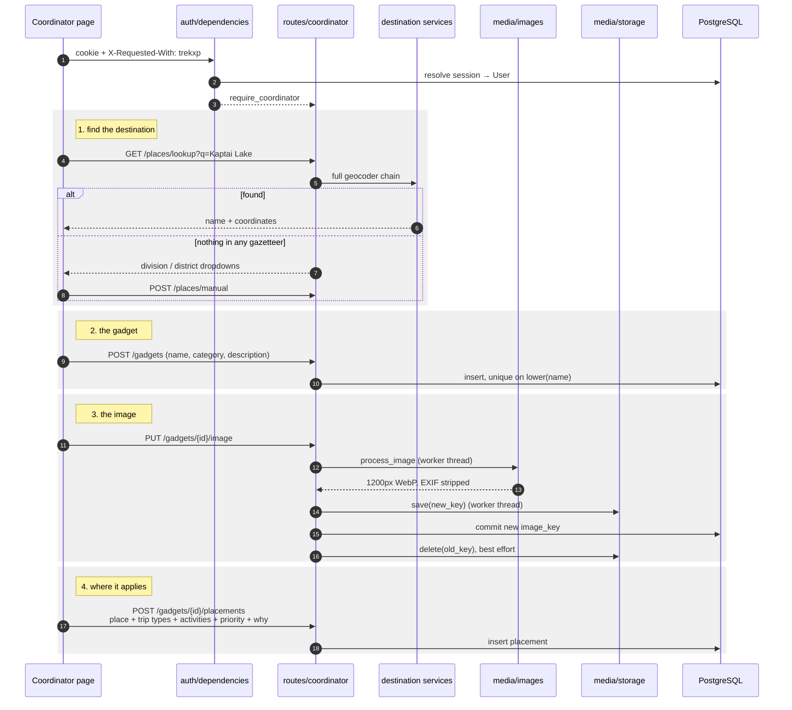
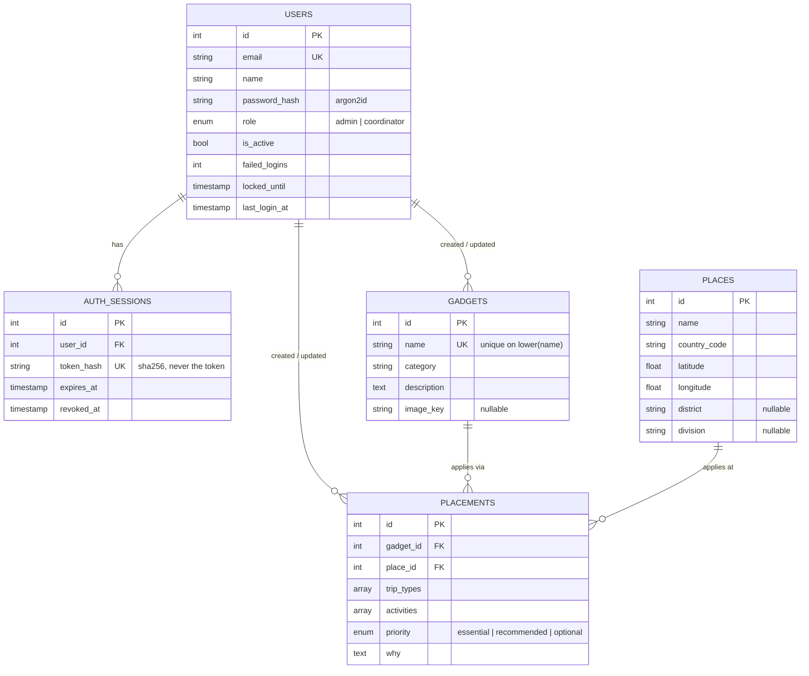

# Trek_XP — Architecture

How the system is put together, what each part is responsible for, and why the
awkward parts are the way they are. For setup and operation, see the
[README](../README.md).

---

## 1. What it does

Trek_XP answers one question: **which gadgets does this specific trip need?**

A traveller fills in a short structured form — where, when, what kind of trip,
what they plan to do. The backend resolves the destination to coordinates,
looks up what the weather was like at those dates last year and what plugs the
country uses, and asks a language model for a prioritised packing list with a
reason for every item.

Separately, **coordinators** sign in to a private area and enter gadgets by
hand against real destinations. That catalog is the long game: today a
traveller's list is model-generated, and the response says so. The plumbing for
community-verified entries to replace or supplement it is already in place
(§6.1) but not yet connected.

---

## 2. Shape of the system

Two faces on one FastAPI application, sharing the destination services and the
database.



The dependency rule is one-directional: **routes assemble, services fetch,
models describe.** A service never imports a route; routes never talk to an
external API directly. That is what makes the test suite able to run offline.

---

## 3. Flow 1 — a traveller asks for a packing list

`POST /recommend`



**Why a worker thread.** The provider SDKs are blocking. Called inline they
would stall the event loop for the whole model call — measured at up to 52
seconds — freezing every other request. `asyncio.to_thread` keeps the loop free.

**Why two timeouts.** `LLM_TIMEOUT_SECONDS` (75) bounds one HTTP attempt inside
the SDK. `LLM_TOTAL_TIMEOUT_SECONDS` (100) wraps the whole call including
retries, and catches an SDK that stalls before its own timer starts. Without
the pair, a stalled upstream left the traveller on a spinner forever with no
error at all.

### What the traveller is told

The response carries `notes` and `sources` alongside the list. **Absences are
stated, not hidden**: if climate data was unavailable, a note says the advice
does not account for weather. If plug data is missing for the country, it says
so. `sources` lists only the services that actually contributed — supplied
coordinates are credited as `supplied_coordinates`, never as a geocoder lookup
that never happened.

### Honesty about provenance

Every `Recommendation` carries `origin` (`llm` / `community`) and `verified`.
Today these are always `llm` / `false`, and a note says the suggestions have
not been community-verified. The fields exist now so the shape does not change
when the catalog lands.

---

## 4. Flow 2 — a coordinator adds a gadget

`/coordinator`, behind sign-in.



### Places no map service knows

Spots like **Bholaganj Sada Pathor**, **Bichanakandi** and **Nilgiri** appear in
no public gazetteer — Open-Meteo has no entry and OpenStreetMap has only a
hotel named after one. Typing a nearby town is actively wrong: "Bholaganj"
resolves to a different Bholaganj 30 km away, "Companiganj" to the one in
Noakhali, 200 km off.

So when lookup finds nothing, the form falls back to **division → district**
dropdowns. The district supplies coordinates, which is precise enough for
climate and therefore for gear, and it records *which* Bholaganj was meant.
Once saved, the place is searchable for every coordinator.

### Image handling

| Step | Rule | Why |
|---|---|---|
| Accept | JPEG / PNG / WebP, **detected by content** not filename | A `.jpg` extension proves nothing |
| Size | 5 MB cap, read one byte past the limit | Know it is too big without buffering it all |
| Guard | reject above 40 megapixels, `verify()` before decode | Decompression-bomb defence |
| Normalise | honour EXIF rotation, longest side 1200px | Consistent display |
| Re-encode | WebP quality 82 | Drops **all** EXIF, including GPS location |

A measured test upload came out at **9.8 KB**. Capacity was never the
constraint on storage choice.

---

## 5. Layer map

| Path | Responsibility |
|---|---|
| `app/main.py` | App assembly, static mounts, startup wiring |
| `app/routes/` | HTTP surface. Assemble inputs, call services, shape responses |
| `app/models/` | Pydantic schemas — the API contract (`trip`, `context`, `recommendation`, `catalog`) |
| `app/services/destination/` | Geocoding, climate, plug data, admin areas |
| `app/services/gadgets/` | `GadgetSource` seam, prompt building, reply parsing |
| `app/services/llm/` | `LLMProvider` seam — Gemini, NVIDIA, retry policy |
| `app/services/media/` | Image processing and `ImageStorage` (local disk / R2) |
| `app/auth/` | Password hashing, DB sessions, role and CSRF dependencies |
| `app/db/` | SQLAlchemy models, engine construction, `get_db` dependency |
| `app/handlers/` | Exception → HTTP status mapping, in one place |
| `app/data/` | Static datasets we own and curate |
| `app/static/` | The two pages: `index.html`, `coordinator.html` |
| `alembic/` | Schema migrations (2 so far) |
| `scripts/create_admin.py` | Creates or resets the first admin, password prompted |

### Errors map in one place

Services raise domain exceptions; they never choose a status code.
`app/handlers/exception_handlers.py` does the whole mapping:

| Exception | Status | Shown to the user |
|---|---|---|
| `DestinationNotFoundException` | 404 | The message, already written for them |
| `DestinationDataException` | 503 | "could not look up that destination" |
| `LLMRateLimitException` | 429 | "reached today's limit" |
| `LLMTimeoutException` | 504 | "taking longer than usual" — retrying may work |
| `LLMException`, `GadgetSourceException` | 503 | "unavailable right now" |
| `ImageStorageException` | 503 | "gadget was saved; try the image again" |
| `InvalidImageException`, `InvalidInputException` | 422 | The message |
| `NotAuthenticatedException` | 401 | "Please sign in." |
| `PermissionDeniedException` | 403 | What is required |
| `ResourceConflictException` | 409 | What already exists |

Internal detail — provider names, bucket names, SQL — is logged, never
returned. A timeout is deliberately **not** reported as "unavailable": one
invites a retry, the other does not.

---

## 6. The data model



**`Placement` is the interesting table.** It is the join that says *this gadget
matters at this place, for these kinds of trip, when you are doing these
things, this much, for this reason.* That is exactly the lookup a community
gadget source will need, which is why it was modelled this way from the start
rather than hanging trip types off the gadget.

Two details worth knowing:

- The gadget name index is `lower(name)`, declared **outside** the class body.
  Written as `func.lower("name")` inside it, SQLAlchemy compiles the string as
  a constant and the index silently guards nothing.
- Enum columns are created with `create_constraint=True`, so the allowed values
  are enforced by Postgres and not only by Python.

### Connecting to Neon

`app/db/engine.py` translates a Neon connection string for asyncpg: rewrites
the scheme, moves `sslmode` into connect args, and drops libpq-only parameters
asyncpg rejects.

When the host contains `-pooler`, the connection goes through **PgBouncer** in
transaction mode, which breaks prepared statements. The engine then switches to
`NullPool`, sets `statement_cache_size=0`, and gives every prepared statement a
UUID name. Without this, the app fails intermittently under concurrency with
"prepared statement already exists" — and only in production, because a direct
local Postgres connection never reproduces it.

---

## 7. Extension seams

Three abstract interfaces, each with a factory that picks the implementation.
They exist so the thing we know is coming does not require a rewrite.

### 7.1 `GadgetSource` — the community catalog seam

```python
class GadgetSource(ABC):
    def recommend(self, context: TripContext) -> list[Recommendation]: ...
```

One implementation today: `LLMGadgetSource`. A `CommunityCatalogSource` reading
`placements` (matched on place + trip type + activities) plugs in behind the
same interface, returning `origin="community"`, `verified=True`. The merge of
both — verified entries first, model suggestions filling gaps — happens in
`get_gadget_source()`, and nothing upstream changes.

**This is the one seam not yet wired up.** Coordinator-entered gadgets do not
reach travellers today.

### 7.2 `LLMProvider` — provider independence

```python
class LLMProvider(ABC):
    def generate(self, prompt: str) -> str: ...
```

`GeminiProvider` and `NvidiaProvider`, chosen by `LLM_PROVIDER`. Each maps its
SDK's failures onto our exceptions, so the rest of the app never sees a
vendor error type. This seam already paid for itself once: the project moved
off Anthropic in an afternoon when the credit balance ran out.

Gemini is configured with `thinking_level=MINIMAL` and a 2000-token output
cap. On Gemini 3, thinking draws from the *same* budget as output — roughly
1,800 of 2,000 tokens went to deliberation and the JSON was cut off mid-array.
A grounded packing list does not need deliberation, and `MAX_TOKENS` finish
reasons are now reported as truncation rather than surfacing later as an
unreadable-JSON error.

### 7.3 `ImageStorage` — local disk or object store

```python
class ImageStorage(ABC):
    def save(self, key: str, data: bytes) -> None: ...
    def delete(self, key: str) -> None: ...
    def url(self, key: str) -> str: ...
```

`LocalImageStorage` for development, `R2ImageStorage` (Cloudflare R2 over its
S3-compatible API) for production — free tiers wipe their disk on every deploy.
Selected by whether the five `R2_*` variables are set.

- **Half-configured R2 is refused at startup.** Falling back to disk would look
  like it worked, then lose every image on the next deploy.
- Keys are random and never reused, so objects upload as immutable WebP and
  browsers may cache them forever. That also keeps repeat views off R2's free
  operation allowance.
- Storage calls run on worker threads — a put to R2 is a network round trip.
- **Cleanup deletes are best effort.** Removing a replaced image is a network
  call that can fail on its own; failing the request would report an error for
  work that had already committed, or mask the error that triggered the cleanup.

---

## 8. External services, and what happens when they fail

| Service | Used for | On failure |
|---|---|---|
| Open-Meteo geocoding | Resolving typed place names | Fall through to OpenStreetMap; unreachable → 503 |
| Open-Meteo archive | Climate for the same dates last year | **Soft** — a note says weather was not considered |
| OpenStreetMap Nominatim | Landmarks Open-Meteo lacks | Return nothing; destination is a 404, not an error |
| Gemini / NVIDIA NIM | The gadget list itself | 429 / 503 / 504 by cause — this one is load-bearing |
| Neon PostgreSQL | Accounts, catalog | Coordinator area 503; the traveller flow does not touch it |
| Cloudflare R2 | Gadget images | Upload 503; reads are served by R2 directly |

**Only two hard dependencies:** a location (no location, nothing to advise on)
and the model. Everything else degrades and says that it did.

Nominatim is used within its usage policy: one request per second, results
cached, no type-ahead, and ODbL attribution carried in the response sources.

---

## 9. Data we own, and why it is static

Three datasets live in the repo rather than being fetched. Each for a reason.

| File | Contents | Why static |
|---|---|---|
| `bd_admin.json` | 8 divisions, 64 districts with coordinates, from OpenStreetMap administrative boundaries | Global gazetteers get roughly **11% of Bangladeshi districts wrong** — Kishoreganj placed in Rangpur Division, Rangpur in Dhaka, Moulvibazar in Chittagong, between 150 and 355 km off. All 64 were cross-checked by hand. |
| `bd_destinations.json` | 22 curated spots across 6 divisions | Several are in no gazetteer at all; their coordinates are ours. Marked `_anchored` where hand-placed. |
| `plugs.json` | Plug types, voltage, frequency by country | Changes on a timescale of decades. A network call per request to learn that Bangladesh is 220V would be absurd. |

Renamed districts keep their former spellings as aliases, so Chittagong,
Comilla, Jessore, Bogra and Netrakona all still match what people type.

---

## 10. Security model

| Concern | Measure |
|---|---|
| Passwords | argon2id. Never logged, never returned |
| Brute force | Account locks for 15 minutes after 5 failed sign-ins |
| Sessions | Stored in the database and revocable. The browser holds only an HttpOnly, SameSite=Strict cookie; the DB stores a SHA-256 hash, never the token |
| Session end | Sign-out, deactivation and password reset all end sessions immediately |
| CSRF | Every write must carry `X-Requested-With: trekxp`. A cross-site form cannot set custom headers, and a cross-site fetch that tries triggers a preflight this API never approves |
| Authorisation | Two roles. Admin manages accounts and catalog; coordinator manages catalog. No public sign-up |
| Uploads | Validated by content, size-capped, re-encoded — which strips EXIF GPS |
| Path traversal | Storage keys are generated, never accepted from input, and both backends re-check the pattern before touching anything |
| Transport | `COOKIE_SECURE=true` in production |
| Secrets | Environment variables only. Never committed, never pasted into chat |

---

## 11. Testing strategy

Two tiers, split by whether they need a database.

```
tests/          offline. Any test that reaches the network fails loudly.
tests/db/       real PostgreSQL, skipped unless TEST_DATABASE_URL is set.
```

The offline tier is enforced, not merely intended: an autouse fixture replaces
`httpx.AsyncClient.send` and the LLM factory with functions that raise. No API
key is needed to run the suite, and a test cannot accidentally spend money or
depend on someone else's uptime.

The DB tier refuses to run if `TEST_DATABASE_URL` equals `DATABASE_URL`,
because it truncates tables.

Two tests worth singling out, because both guard bugs that every other test
missed:

- **`test_form_contract.py`** parses the JSON literal out of
  `coordinator.html` and compares its keys against `PlaceIn.model_fields`.
  The form once dropped `district` and `division` silently while every API
  test passed, because the tests sent their own correct payloads. The contract
  that broke was between the page and the schema, so that is what is tested.
- **`test_migrations.py`** autogenerates a migration against the live schema
  and asserts it is empty — models and migrations cannot drift apart unnoticed.

---

## 12. Where it stands

**Working:** traveller flow end to end · destination resolution including
landmarks no gazetteer has · climate and plug context · Gemini gadget lists
with bounded timeouts · full coordinator area with auth, catalog, placements
and image upload · R2 storage · 235 tests.

**Not built yet:**

| Gap | Note |
|---|---|
| Community catalog not connected | `/recommend` is model-only. The `GadgetSource` seam and the `placements` table are both ready; nothing reads them |
| Not deployed | Needs Procfile, pinned Python, CORS lockdown, admin password from platform secrets, `alembic upgrade head` against Neon |
| Guardrails are prose, not rules | Drone bans and airline power-bank limits are mentioned in the prompt. They belong in a data file checked deterministically, so they are testable without the model |
| "Share experience" is a stub | The button shows a toast. No reviews backend |
| No caching | Every request re-geocodes and re-asks the model. Identical trips should not cost twice |
| Hero image missing | The restyled traveller page has no photo |
| Facebook contributor channel | Designed as consent-based only — contributors opt in, nothing is scraped. Not started |

**One deliberate inconsistency:** `baggage` was removed from the traveller form
but remains an optional field on `TripRequest`, and the prompt still honours it
when supplied. The airline power-bank rule it drives only matters on flights,
and most trips here are by road or rail — so it is asked for by no one and
available to any caller that knows about it.
